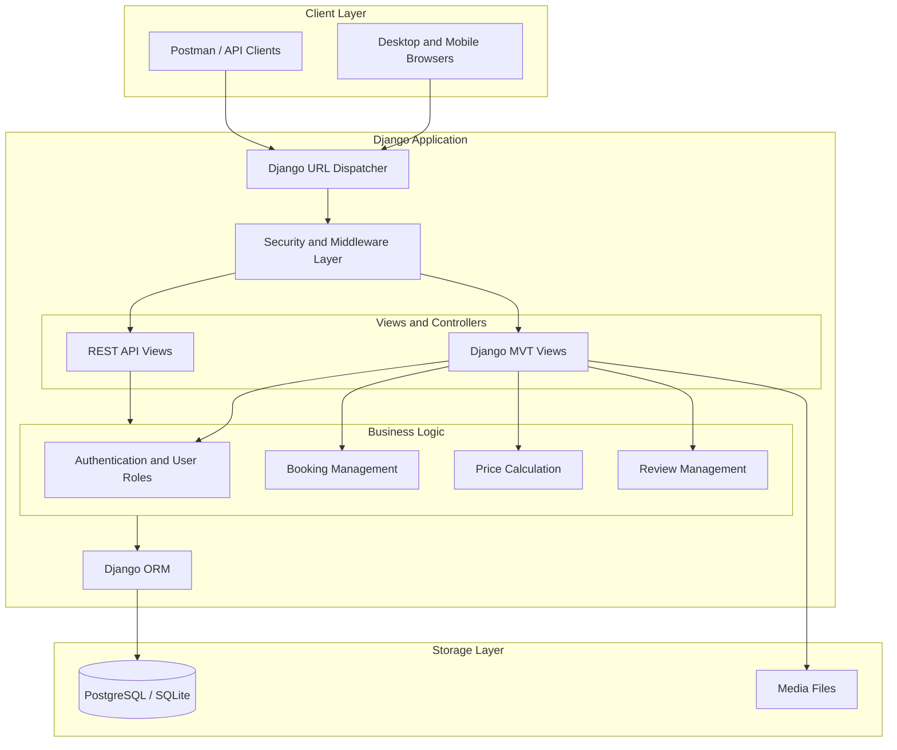
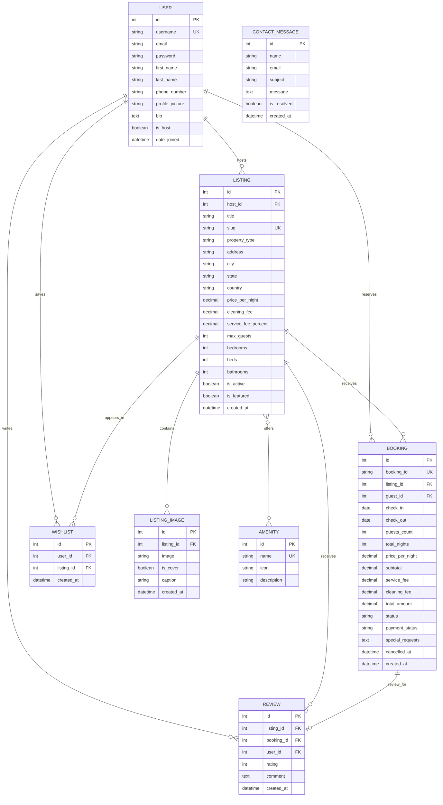
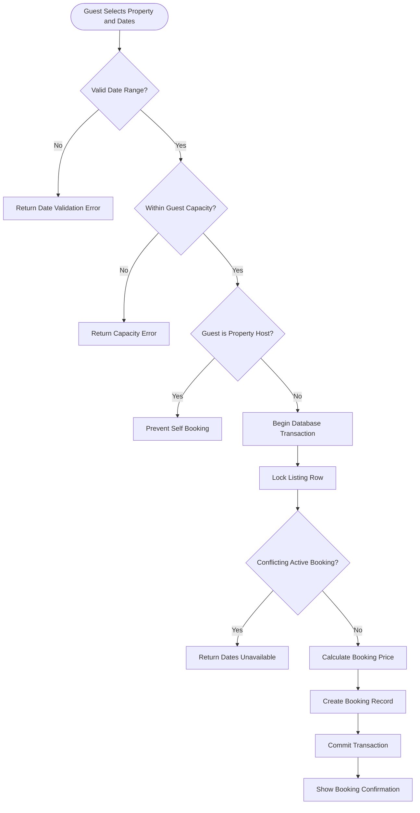

# ApnaStay – Full-Stack Airbnb-Inspired Accommodation Booking Platform

> **"Apna Stay, Apni Choice."**  
> A full-stack, database-driven accommodation booking platform built using **Python, Django, Django REST Framework, PostgreSQL, SQLite, and Bootstrap 5**.
>
> Developed as a B.Tech Computer Science Full-Stack Engineering Capstone Project.

---

## 1. Project Introduction

**ApnaStay** is an Airbnb-inspired accommodation booking platform designed around the Indian travel and hospitality ecosystem.

It connects two primary types of users:

- **Guests:** Search for accommodations across India, explore property details, make reservations, calculate trip pricing, manage bookings, save properties to wishlists, and submit reviews.
- **Hosts:** Create and manage property listings, upload property images, manage reservations, and view booking information through a host dashboard.

A registered user can act as both a **Guest** and a **Host** using a single account.

The platform includes a Django-powered web application and REST APIs built with Django REST Framework.

---

## 2. Technology Stack

### Backend

- **Python 3.12+**
- **Django 6.1:** Web framework following the Model-View-Template (MVT) architecture.
- **Django REST Framework:** REST API development, serializers, authentication, and permissions.
- **Django ORM:** Database operations, relationships, filtering, aggregation, and transactions.
- **psycopg 3:** PostgreSQL database adapter.
- **Pillow:** Image processing and image upload support.
- **python-dotenv:** Environment variable management using `.env`.

### Database

- **PostgreSQL:** Primary database when `USE_POSTGRES=True`.
- **SQLite:** Local database option when `USE_POSTGRES=False`.

Database selection is controlled through an environment variable. PostgreSQL must be running and reachable when PostgreSQL is selected. The application does not automatically switch to SQLite if the PostgreSQL server is unavailable.

### Frontend

- HTML5
- CSS3
- Bootstrap 5.3.3
- Bootstrap Icons 1.11.3
- Vanilla JavaScript (ES6+)

Frontend functionality includes dynamic booking calculations, wishlist interactions, date selection, and image previews.

---

## 3. System Architecture Diagram



---

## 4. Database Schema (Entity-Relationship Diagram)

The application uses relational database models to manage users, listings, bookings, reviews, wishlists, and contact messages.



---

## 5. Booking and Overlap Prevention Flowchart

The booking workflow validates the requested dates, guest capacity, and property ownership before creating a reservation.



---

## 6. Installation and Local Setup

Follow these steps to run ApnaStay on your local machine.

### Prerequisites

- Python 3.12 or later
- Git
- PostgreSQL (optional if you intend to use SQLite)
- A code editor such as Visual Studio Code

### Step 1: Clone the Repository

```bash
git clone YOUR_GITHUB_REPOSITORY_URL
cd apnastay
```

Replace `YOUR_GITHUB_REPOSITORY_URL` with your actual GitHub repository URL.

If you have already downloaded the project, open its folder in your terminal instead.

### Step 2: Create a Virtual Environment

**Windows PowerShell:**

```powershell
python -m venv .venv
.\.venv\Scripts\Activate.ps1
```

**Windows CMD:**

```cmd
python -m venv .venv
.venv\Scripts\activate.bat
```

**macOS / Linux:**

```bash
python -m venv .venv
source .venv/bin/activate
```

### Step 3: Install Dependencies

```bash
python -m pip install -r requirements.txt
```

### Step 4: Configure Environment Variables

Create your local `.env` file by copying `.env.example`.

**Windows PowerShell:**

```powershell
Copy-Item .env.example .env
```

**macOS / Linux:**

```bash
cp .env.example .env
```

Open `.env` and configure your local settings.

Example configuration:

```ini
DEBUG=True
SECRET_KEY=replace-with-your-own-secret-key
ALLOWED_HOSTS=localhost,127.0.0.1

# Database selection
USE_POSTGRES=True

# PostgreSQL configuration
DB_NAME=apnastay_db
DB_USER=postgres
DB_PASSWORD=your_local_postgres_password
DB_HOST=localhost
DB_PORT=5432
```

**Important environment configuration notes:**

- Keep `.env` private. Never commit it to GitHub.
- Generate your own secret key. Do not use the example placeholder as a real production secret.
- Set `USE_POSTGRES=True` to use PostgreSQL.
- Set `USE_POSTGRES=False` to use the local SQLite database (`db.sqlite3`).
- When PostgreSQL is selected, make sure the PostgreSQL service is running and the configured database exists.
- `.env.example` contains placeholders only. Add your own local values to `.env`.

### Step 5: Run Database Migrations

```bash
python manage.py migrate
```

This creates the database tables required by the application.

### Step 6: Verify the Database Connection

```bash
python manage.py check_db
```

This project includes a database connectivity management command.

### Step 7: Populate Sample Data

```bash
python manage.py populate_sample_data
```

This command populates the database with sample application data, if the management command is included in the project.

### Step 8: Start the Development Server

```bash
python manage.py runserver
```

Open the application in your browser:

**http://127.0.0.1:8000/**

---

## 7. Demo Credentials

The project may include sample accounts for local demonstration and college project evaluation.

If the sample-data command creates these accounts, the following credentials can be used in a local development environment:

| Role | Username | Password | Purpose |
|---|---|---|---|
| System Admin | `admin` | `admin123` | Django Admin access |
| Host 1 | `host1` | `host123` | Host dashboard and listings |
| Host 2 | `host2` | `host234` | Host dashboard and listings |
| Guest 1 | `guest1` | `guest123` | Guest dashboard and bookings |

**Security note:** These are demonstration credentials only. Do not use these passwords for a deployed application or a real account. Change or remove default credentials before deployment.

---

## 8. Automated Test Suite

The project includes Django tests covering application functionality such as authentication, permissions, listings, bookings, reviews, wishlists, and REST API endpoints.

Run the test suite using:

```bash
python manage.py test
```

Django will display the number of tests executed and whether they passed.

---

## 9. REST API Endpoint Reference

The application provides REST API endpoints for authentication, listings, bookings, reviews, and wishlists.

| Category | Method | Endpoint | Description | Authentication |
|---|---|---|---|---|
| Auth | POST | `/api/auth/register/` | Register a new user | Public |
| Auth | POST | `/api/auth/login/` | Log in and receive an authentication token | Public |
| Auth | POST | `/api/auth/logout/` | Log out the authenticated user | Required |
| Auth | GET | `/api/auth/profile/` | Retrieve authenticated user profile | Required |
| Listings | GET | `/api/listings/` | List properties with search and filters | Public |
| Listings | POST | `/api/listings/` | Create a property listing | Required |
| Listings | GET | `/api/listings/{id}/` | Retrieve property details | Public |
| Listings | PUT | `/api/listings/{id}/` | Update a property listing | Owner |
| Listings | DELETE | `/api/listings/{id}/` | Delete a property listing | Owner |
| Bookings | GET | `/api/bookings/` | List relevant bookings | Required |
| Bookings | POST | `/api/bookings/` | Create a booking | Required |
| Bookings | GET | `/api/bookings/{id}/` | Retrieve booking details | Participant |
| Bookings | POST | `/api/bookings/{id}/cancel/` | Cancel an eligible booking | Participant |
| Reviews | GET | `/api/listings/{id}/reviews/` | List property reviews | Public |
| Reviews | POST | `/api/listings/{id}/reviews/` | Submit a property review | Required |
| Reviews | PUT | `/api/reviews/{id}/` | Update a review | Author |
| Reviews | DELETE | `/api/reviews/{id}/` | Delete a review | Author |
| Wishlist | GET | `/api/wishlist/` | Retrieve saved properties | Required |
| Wishlist | POST | `/api/wishlist/` | Add a property to wishlist | Required |
| Wishlist | DELETE | `/api/wishlist/{id}/` | Remove a saved property | Required |
| System | GET | `/health/` | Check application health | Public |

### Postman Collection

A Postman collection is included in the project repository:

`ApnaStay_Postman_Collection.json`

Import this file into Postman to test the available API endpoints.

---

## 10. College Viva and Technical Explanation Guide

### Q1. How does ApnaStay prevent double-booking?

The booking workflow validates the requested dates and checks for overlapping bookings before creating a reservation.

Database transactions and row locking can be used to protect the booking operation against concurrent requests. In this project, the booking implementation should be reviewed in `bookings/views.py` to understand the exact locking and transaction behavior.

### Q2. How are reviews associated with bookings?

Reviews are associated with properties, users, and bookings. This relationship allows the application to connect a review to the stay it refers to.

The review validation logic determines whether a user is eligible to submit a review. The relevant implementation is in the review models and views.

### Q3. How are Guest and Host roles handled?

ApnaStay uses a custom user model in `accounts/models.py`.

A user can use the same account to book accommodations as a guest and manage property listings as a host. The `is_host` field is used to represent host capability.

### Q4. How is booking pricing calculated?

The application calculates booking costs using the selected check-in and check-out dates and the property's pricing information.

The price breakdown can include:

- Number of nights
- Price per night
- Subtotal
- Cleaning fee
- Service fee
- Total booking amount

The frontend can update the displayed price when users change their selected dates.

### Q5. How does Django ORM help with database operations?

Django ORM provides a Python interface for interacting with relational databases.

It supports:

- Model-based database operations
- Filtering and sorting
- Relationships between models
- Aggregations and annotations
- Transactions
- Query optimization using methods such as `select_related()` and `prefetch_related()`

---

## 11. Project Directory Structure

The main project structure is organized into Django applications based on functionality.

```text
apnastay/
│
├── manage.py
├── requirements.txt
├── README.md
├── .env.example
├── .gitignore
├── ApnaStay_Postman_Collection.json
│
├── apnastay_project/
│   ├── settings.py
│   ├── urls.py
│   ├── wsgi.py
│   └── asgi.py
│
├── accounts/
│   ├── models.py
│   ├── views.py
│   ├── forms.py
│   └── tests.py
│
├── listings/
│   ├── models.py
│   ├── views.py
│   ├── forms.py
│   └── tests.py
│
├── bookings/
│   ├── models.py
│   ├── views.py
│   ├── forms.py
│   └── tests.py
│
├── reviews/
│   ├── models.py
│   ├── views.py
│   └── tests.py
│
├── wishlists/
│   ├── models.py
│   ├── views.py
│   └── tests.py
│
├── core/
│   ├── models.py
│   ├── views.py
│   ├── context_processors.py
│   └── management/
│       └── commands/
│           ├── populate_sample_data.py
│           └── check_db.py
│
├── api/
│   ├── serializers.py
│   ├── views.py
│   ├── permissions.py
│   └── tests.py
│
├── static/
│   ├── css/
│   └── js/
│
├── media/
│   └── listings/
│
└── templates/
    ├── base.html
    ├── navbar.html
    ├── footer.html
    ├── core/
    ├── accounts/
    ├── listings/
    ├── bookings/
    ├── reviews/
    └── wishlists/
```

---

## 12. Verification Checklist

The following checklist summarizes the main project areas.

- [x] Django project structure and application configuration
- [x] PostgreSQL database configuration
- [x] SQLite database option
- [x] Custom user model supporting Guest and Host capabilities
- [x] Property listing management
- [x] Multiple property image uploads
- [x] Property search and filtering
- [x] Booking creation and management
- [x] Booking date and guest-capacity validation
- [x] Booking price calculation
- [x] Review management
- [x] Wishlist functionality
- [x] Guest and Host dashboards
- [x] Django REST Framework API integration
- [x] API authentication and permissions
- [x] Postman collection
- [x] Django Admin integration
- [x] Sample-data management command
- [x] Database connectivity management command
- [x] Responsive frontend using Bootstrap
- [x] Project documentation and college viva guide

Run the test suite and verify each feature locally before treating all checklist items as fully tested.

---

## 13. Future Improvements

Possible future enhancements include:

- Online payment gateway integration
- Email and SMS booking notifications
- Map-based property discovery
- Advanced host analytics
- Deployment with a production database and cloud media storage
- Additional automated tests
- Improved booking availability management

---

## 14. Project Purpose

ApnaStay was developed as a full-stack academic project to demonstrate practical implementation of web development concepts, relational database management, backend development, frontend integration, REST API design, authentication, and application testing.

**ApnaStay – Apna Stay, Apni Choice.**